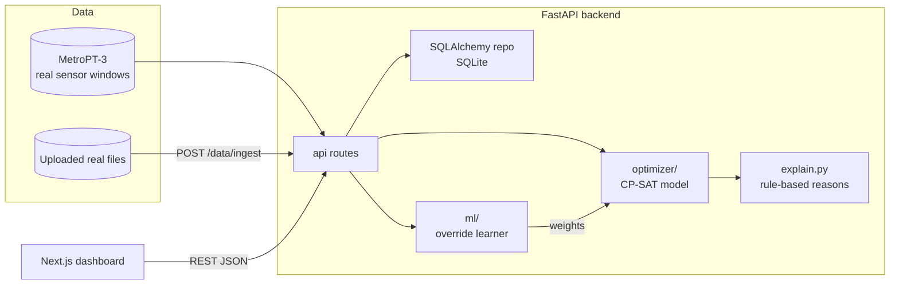

# MetroSched — Architecture

CSE 471 class project based on SIH25081 (KMRL nightly train induction planning).
No synthetic data is used. The default fleet is built from real MetroPT-3 compressor data (`app/metropt_fleet.py`); real files uploaded through `/data/ingest` replace it. Inputs with no real source are left empty and the rules that need them are reported as not checked. See `ASSUMPTIONS.md`.

## Scope decisions

- Supervisor first view: **ranked induction list** (rank, train, assignment, score, expandable reasons, conflict badges).
- Multi-depot: **data-model + test level**. Every record carries `depot_id`. The demo shows Muttom depot only; a 40-train / 2-depot test proves scale.
- Design skills `engineering:system-design` / `engineering:architecture` were not installed; this design was done directly.

## Components

### Backend modules

| Module | Responsibility |
|---|---|
| `backend/app/models.py` | SQLAlchemy tables: depot, bay, trainset, certificate, job_card, branding_contract, cleaning_slot, plan, plan_item, override |
| `backend/app/schemas.py` | Pydantic v2 request/response models |
| `backend/app/main.py` | FastAPI routes: `/data/ingest`, `/plan/generate`, `/plan/simulate`, `/plan/override`, `/plan/history`, `/fleet/status` |
| `backend/optimizer/model.py` | Builds CP-SAT model from a `FleetSnapshot`; returns assignments or a relaxation report |
| `backend/optimizer/constraints.py` | Pure eligibility checks (cert validity, critical job cards) — shared by optimizer and explanations |
| `backend/optimizer/explain.py` | Converts constraint facts + objective terms into human-readable reasons/violations |
| `backend/optimizer/simulate.py` | Applies what-if mutations to a snapshot, re-solves, diffs plans |
| `backend/rag/kb.py` | Retrieval-only knowledge base: chunks `data/kb/` (procedures, MetroPT-3 failure reports, past work orders), TF-IDF index, cosine ranking, per-train issue lookup |
| `backend/ml/apu_risk.py` | Compressor (APU) fault risk: random forest on real MetroPT-3 sensor windows (`data/metropt3/`), out-of-fold scores, seeded slice per trainset |
| `backend/ml/learner.py` | Learns soft weights from overrides (logistic regression on feature deltas); default weights if < 20 overrides |

### Optimization model

Variables: `x[t,a]` ∈ {0,1} for train t, assignment a ∈ {REVENUE, STANDBY, IBL}; `clean[t]` ∈ {0,1}.

Hard constraints:
1. Exactly one assignment per train.
2. Any expired certificate (Rolling-Stock, Signalling, Telecom) at service date ⇒ `x[t,IBL]=1`.
3. Any open critical job card ⇒ `x[t,IBL]=1`.
4. Revenue count = service requirement (`required_revenue`), standby ≥ `min_standby`.
5. Trains due for cleaning that go to revenue must take a cleaning slot; Σ`clean` ≤ cleaning slots tonight.
6. IBL count ≤ IBL bay capacity.

Soft objective (weighted, integer-scaled):
- branding shortfall hours for wrapped trains not in revenue,
- mileage deviation: revenue trains with km above fleet mean penalised, below rewarded,
- shunting moves: trains whose bay position blocks morning turnout for revenue,
- standby buffer bonus above minimum,
- compressor fault risk (MetroPT-3) for trains in revenue (weight 500).

The solver runs on one worker thread so tied optima resolve the same way each run.

Infeasible ⇒ re-solve with relaxation booleans per hard-constraint group (revenue target, cleaning capacity, IBL capacity); report the minimal set relaxed. Certificate / job-card rules are never relaxed — they reduce the available fleet instead.

Ranking: revenue trains first by per-train score (objective contribution), then standby, then IBL.

### Data flow per night
1. Fleet: uploaded real files if present, else the MetroPT-3 fleet (built per request; nothing stored).
2. `/plan/generate` → load snapshot (+ MetroPT-3 compressor risk per train) → ML weights → CP-SAT (time limit 8 s) → explanations → persist plan.
3. Supervisor overrides via `/plan/override` → stored → learner retrains on next generate.
4. `/plan/simulate` → copy snapshot, apply scenario mutations, solve, return diff.

### Frontend pages (Next.js App Router)
`/` Tonight's Plan · `/fleet` Fleet Health · `/usage` Compressor Usage · `/depot` Depot · `/simulate` What-If · `/overrides` Override Log · `/knowledge` Knowledge Base. Persistent "No synthetic data" banner; pages for unloaded inputs show a "not loaded" notice.

### Testing
pytest (constraints, optimizer, API, ML fallback, 40-train perf < 10 s), Vitest (components/utilities), Playwright smoke (generate plan in browser).
